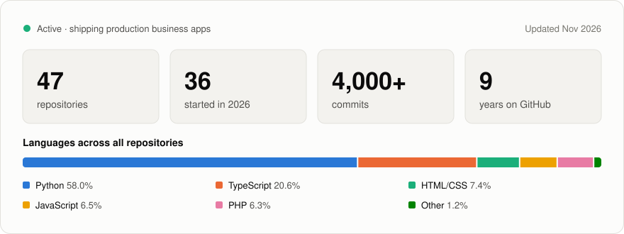

<h1 align="center">syamkerai</h1>

<b>ERPNext / Frappe developer</b> · business apps, payment integrations and websites

  <picture>
    <source media="(prefers-color-scheme: dark)" srcset="assets/dashboard-dark.svg">
    
  </picture>

### What I build

| | Area | Highlights |
|:-:|---|---|
| 🧩 | **ERPNext & Frappe apps** | Custom apps for attendance, maintenance, procurement, project stock control, lending/SACCO, asset tracking (RFID + QR) and management reporting, on ERPNext v15 and v16 |
| 💳 | **Payments & compliance** | M-Pesa C2B, STK push and B2C; bank integrations and automated reconciliation; tax PIN / KYC verification |
| 🛒 | **Websites & e-commerce** | Next.js storefronts on a Medusa backend synced with ERPNext; fast static company websites with auto-deploy |
| 🖥️ | **Ops & infrastructure** | Self-hosted VPS with Caddy, biometric attendance device servers, dispatch and fleet management, print hub |
| 🤖 | **AI & automation** | Agent workflows and AI-assisted permission auditing for ERP systems |

### Tech stack

  
  
  
  
  
  
  
  
  
  
  
  
  

Most of my work lives in private repositories. Stats cover all of them and were last refreshed in November 2026.
